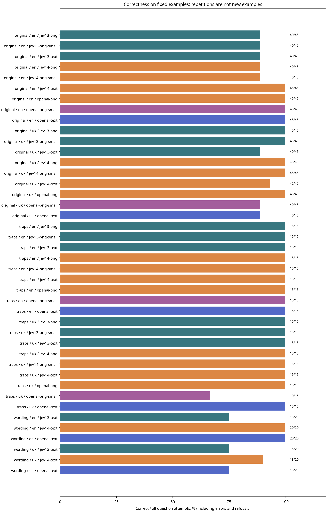
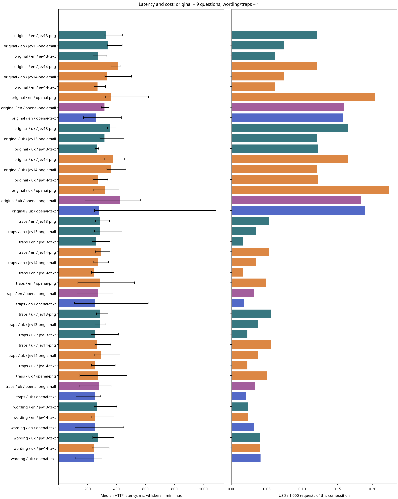

# Jev × OpenAI Decisions: results

Run status: **complete**. Started: 2026-10-16T13:34:33.092911+00:00 (UTC).
Execution: **live**. mock = synthetic tests, not model results.
Planned measurements: 480; not executed: 0.
Measured requests: 480; warmups: 18.
Dataset hash: `1db58f724d1aa799899f6433598cc9f7f376675ff9fd54ec61fc6b8dee602351`.
Pricing checked: 2026-10-16. Standard direct API input pricing; no regional premium or long-context multiplier. Output is free. Recheck sources before each live run.
Known subtotal for the entire run, including warmup: \$0.02828292; requests with unknown cost: 0.

## Correctness and stability

Correct / attempts includes transport errors and refusals in the denominator: it measures successful delivery of a correct answer. The separate accuracy_answered field in JSON/CSV counts only returned choice answers.

| Block | Language | Mode | Correct / attempts | Unique questions | Request errors | Refusals | Questions with changed choices |
|---|---|---|---:|---:|---:|---:|---:|
| original | en | jev13-png | 40/45 | 9 | 0 | 0 | 0 |
| original | en | jev13-png-small | 40/45 | 9 | 0 | 0 | 0 |
| original | en | jev13-text | 40/45 | 9 | 0 | 0 | 0 |
| original | en | jev14-png | 40/45 | 9 | 0 | 0 | 0 |
| original | en | jev14-png-small | 40/45 | 9 | 0 | 0 | 0 |
| original | en | jev14-text | 45/45 | 9 | 0 | 0 | 0 |
| original | en | openai-png | 45/45 | 9 | 0 | 0 | 0 |
| original | en | openai-png-small | 45/45 | 9 | 0 | 0 | 0 |
| original | en | openai-text | 45/45 | 9 | 0 | 0 | 0 |
| original | uk | jev13-png | 45/45 | 9 | 0 | 0 | 0 |
| original | uk | jev13-png-small | 45/45 | 9 | 0 | 0 | 0 |
| original | uk | jev13-text | 40/45 | 9 | 0 | 0 | 0 |
| original | uk | jev14-png | 45/45 | 9 | 0 | 0 | 0 |
| original | uk | jev14-png-small | 45/45 | 9 | 0 | 0 | 0 |
| original | uk | jev14-text | 42/45 | 9 | 0 | 0 | 1 |
| original | uk | openai-png | 45/45 | 9 | 0 | 0 | 0 |
| original | uk | openai-png-small | 40/45 | 9 | 0 | 0 | 0 |
| original | uk | openai-text | 40/45 | 9 | 0 | 0 | 0 |
| traps | en | jev13-png | 15/15 | 3 | 0 | 0 | 0 |
| traps | en | jev13-png-small | 15/15 | 3 | 0 | 0 | 0 |
| traps | en | jev13-text | 15/15 | 3 | 0 | 0 | 0 |
| traps | en | jev14-png | 15/15 | 3 | 0 | 0 | 0 |
| traps | en | jev14-png-small | 15/15 | 3 | 0 | 0 | 0 |
| traps | en | jev14-text | 15/15 | 3 | 0 | 0 | 0 |
| traps | en | openai-png | 15/15 | 3 | 0 | 0 | 0 |
| traps | en | openai-png-small | 15/15 | 3 | 0 | 0 | 0 |
| traps | en | openai-text | 15/15 | 3 | 0 | 0 | 0 |
| traps | uk | jev13-png | 15/15 | 3 | 0 | 0 | 0 |
| traps | uk | jev13-png-small | 15/15 | 3 | 0 | 0 | 0 |
| traps | uk | jev13-text | 15/15 | 3 | 0 | 0 | 0 |
| traps | uk | jev14-png | 15/15 | 3 | 0 | 0 | 0 |
| traps | uk | jev14-png-small | 15/15 | 3 | 0 | 0 | 0 |
| traps | uk | jev14-text | 15/15 | 3 | 0 | 0 | 0 |
| traps | uk | openai-png | 15/15 | 3 | 0 | 0 | 0 |
| traps | uk | openai-png-small | 10/15 | 3 | 0 | 0 | 0 |
| traps | uk | openai-text | 15/15 | 3 | 0 | 0 | 0 |
| wording | en | jev13-text | 15/20 | 4 | 0 | 0 | 0 |
| wording | en | jev14-text | 20/20 | 4 | 0 | 0 | 0 |
| wording | en | openai-text | 20/20 | 4 | 0 | 0 | 0 |
| wording | uk | jev13-text | 15/20 | 4 | 0 | 0 | 0 |
| wording | uk | jev14-text | 18/20 | 4 | 0 | 0 | 1 |
| wording | uk | openai-text | 15/20 | 4 | 0 | 0 | 0 |

## Probabilities and confidence

Both APIs returned a probability distribution over choices and a separate confidence field. These are API scores, not empirically established probabilities of correctness; equivalent calibration across providers is not assumed. This section includes measured choice answers only, excluding warmups, refusals, and missing answers.

### Incorrect answers

Each row summarizes incorrect attempts for one question and condition. P(selected) is the probability assigned to the chosen incorrect option; P(expected) is the probability assigned to the answer key. Medians are computed separately. A stable choice can still have changing probability values.

| Example | Mode | Question | Incorrect attempts | Median P(selected) | Median P(expected) | Median confidence | Confidence min–max |
|---|---|---|---:|---:|---:|---:|---:|
| almost-en | jev13-text | q1 | 5 | 67.0% | 33.0% | 0.560 | 0.370–0.670 |
| almost-uk | jev13-text | q1 | 5 | 66.0% | 31.0% | 0.550 | 0.400–0.570 |
| almost-uk | jev14-text | q1 | 2 | 54.0% | 43.5% | 0.390 | 0.350–0.430 |
| almost-uk | openai-text | q1 | 5 | 89.0% | 9.0% | 0.850 | 0.850–0.850 |
| negation-uk | openai-png-small | q1 | 5 | 76.0% | 12.0% | 0.680 | 0.680–0.680 |
| original-en | jev13-png | q1 | 5 | 89.0% | 11.0% | 0.850 | 0.810–0.880 |
| original-en | jev13-png-small | q1 | 5 | 55.0% | 20.0% | 0.400 | 0.330–0.450 |
| original-en | jev13-text | q1 | 5 | 67.0% | 33.0% | 0.560 | 0.470–0.590 |
| original-en | jev14-png | q1 | 5 | 62.0% | 38.0% | 0.490 | 0.430–0.570 |
| original-en | jev14-png-small | q1 | 5 | 65.0% | 33.0% | 0.530 | 0.390–0.600 |
| original-uk | jev13-text | q1 | 5 | 63.0% | 34.0% | 0.510 | 0.450–0.600 |
| original-uk | jev14-text | q1 | 3 | 51.0% | 47.0% | 0.350 | 0.330–0.350 |
| original-uk | openai-png-small | q6 | 5 | 30.0% | 29.0% | 0.070 | 0.070–0.070 |
| original-uk | openai-text | q1 | 5 | 89.0% | 9.0% | 0.850 | 0.850–0.850 |

### Confidence by outcome

Counts are repeated question attempts, not independent examples. Results are grouped by requested model, keeping Jev versions separate. Workloads depend on the run matrix; these aggregates are descriptive, not a ranking.

| Model | Outcome | Question attempts | Median confidence | Confidence min–max |
|---|---|---:|---:|---:|
| gpt-6-luna | incorrect | 20 | 0.765 | 0.070–0.850 |
| gpt-6-luna | correct | 380 | 1.000 | 0.360–1.000 |
| jev-1.13.0 | incorrect | 30 | 0.550 | 0.330–0.880 |
| jev-1.13.0 | correct | 370 | 1.000 | 0.290–1.000 |
| jev-1.14.0 | incorrect | 15 | 0.440 | 0.330–0.600 |
| jev-1.14.0 | correct | 385 | 1.000 | 0.320–1.000 |

Observed interpretation:

- gpt-6-luna: incorrect-answer confidence was 0.070–0.850, versus 0.360–1.000 for correct answers. The ranges overlap in this sample.
- gpt-6-luna: a correct answer with the lowest observed confidence occurred on original-en / openai-png / q1: confidence 0.360, P(selected) 52.0%. Low confidence does not itself establish an error.
- jev-1.13.0: incorrect-answer confidence was 0.330–0.880, versus 0.290–1.000 for correct answers. The ranges overlap in this sample.
- jev-1.13.0: a correct answer with the lowest observed confidence occurred on original-uk / jev13-png-small / q1: confidence 0.290, P(selected) 47.0%. Low confidence does not itself establish an error.
- jev-1.14.0: incorrect-answer confidence was 0.330–0.600, versus 0.320–1.000 for correct answers. The ranges overlap in this sample.
- jev-1.14.0: a correct answer with the lowest observed confidence occurred on almost-uk / jev14-text / q1: confidence 0.320, P(selected) 49.0%. Low confidence does not itself establish an error.

High probability on a wrong option can coexist with repeated, stable errors. Any threshold suggested by the observed ranges is a post-hoc observation on these fixed examples, not a validated error detector for new tasks.

## Latency and cost

Latency includes valid HTTP responses (including refusals), excluding warmup. Transport/schema errors and their durations remain in requests.csv. Missing usage means unknown cost, not zero.

| Block | Language | Mode | n | Median, ms | Min–max, ms | USD / 1,000 requests | Returned model |
|---|---|---|---:|---:|---:|---:|---|
| original | en | jev13-png | 5 | 329.08 | 318.99–440.95 | 0.120960 | jev-1.13.0 |
| original | en | jev13-png-small | 5 | 343.53 | 336.36–439.51 | 0.074390 | jev-1.13.0 |
| original | en | jev13-text | 5 | 274.42 | 238.34–333.42 | 0.061782 | jev-1.13.0 |
| original | en | jev14-png | 5 | 408.86 | 362.58–425.63 | 0.120985 | jev-1.14.0 |
| original | en | jev14-png-small | 5 | 336.33 | 319.79–503.65 | 0.074424 | jev-1.14.0 |
| original | en | jev14-text | 5 | 268.40 | 244.56–323.84 | 0.061782 | jev-1.14.0 |
| original | en | openai-png | 5 | 364.15 | 324.87–619.97 | 0.202700 | gpt-6-luna |
| original | en | openai-png-small | 5 | 317.33 | 295.51–348.67 | 0.159000 | gpt-6-luna |
| original | en | openai-text | 5 | 256.75 | 172.25–434.37 | 0.158000 | gpt-6-luna |
| original | uk | jev13-png | 5 | 353.94 | 337.18–395.48 | 0.164396 | jev-1.13.0 |
| original | uk | jev13-png-small | 5 | 316.74 | 284.38–451.93 | 0.121447 | jev-1.13.0 |
| original | uk | jev13-text | 5 | 265.03 | 252.81–277.02 | 0.122556 | jev-1.13.0 |
| original | uk | jev14-png | 5 | 373.49 | 315.42–454.93 | 0.164396 | jev-1.14.0 |
| original | uk | jev14-png-small | 5 | 359.49 | 333.09–464.31 | 0.121464 | jev-1.14.0 |
| original | uk | jev14-text | 5 | 270.14 | 236.46–340.45 | 0.122556 | jev-1.14.0 |
| original | uk | openai-png | 5 | 317.83 | 242.24–417.81 | 0.223200 | gpt-6-luna |
| original | uk | openai-png-small | 5 | 426.83 | 181.85–566.58 | 0.183300 | gpt-6-luna |
| original | uk | openai-text | 5 | 276.72 | 248.31–1087.33 | 0.189600 | gpt-6-luna |
| traps | en | jev13-png | 15 | 284.45 | 254.93–351.47 | 0.052590 | jev-1.13.0 |
| traps | en | jev13-png-small | 15 | 286.59 | 248.37–438.90 | 0.034978 | jev-1.13.0 |
| traps | en | jev13-text | 15 | 257.68 | 230.65–355.34 | 0.016646 | jev-1.13.0 |
| traps | en | jev14-png | 15 | 290.84 | 253.73–355.32 | 0.052584 | jev-1.14.0 |
| traps | en | jev14-png-small | 15 | 271.53 | 242.98–344.42 | 0.034944 | jev-1.14.0 |
| traps | en | jev14-text | 15 | 246.78 | 227.90–382.43 | 0.016646 | jev-1.14.0 |
| traps | en | openai-png | 15 | 287.92 | 132.53–524.68 | 0.048533 | gpt-6-luna |
| traps | en | openai-png-small | 15 | 271.45 | 126.84–374.93 | 0.031433 | gpt-6-luna |
| traps | en | openai-text | 15 | 250.82 | 109.88–619.90 | 0.017767 | gpt-6-luna |
| traps | uk | jev13-png | 15 | 288.54 | 262.29–341.48 | 0.055465 | jev-1.13.0 |
| traps | uk | jev13-png-small | 15 | 285.93 | 252.24–326.29 | 0.037850 | jev-1.13.0 |
| traps | uk | jev13-text | 15 | 253.27 | 223.94–412.74 | 0.022442 | jev-1.13.0 |
| traps | uk | jev14-png | 15 | 266.64 | 250.12–360.19 | 0.055462 | jev-1.14.0 |
| traps | uk | jev14-png-small | 15 | 292.13 | 249.37–424.26 | 0.037836 | jev-1.14.0 |
| traps | uk | jev14-text | 15 | 252.05 | 227.81–391.30 | 0.022442 | jev-1.14.0 |
| traps | uk | openai-png | 15 | 273.05 | 146.41–472.84 | 0.050133 | gpt-6-luna |
| traps | uk | openai-png-small | 15 | 280.30 | 142.77–362.30 | 0.033033 | gpt-6-luna |
| traps | uk | openai-text | 15 | 252.07 | 119.46–290.52 | 0.020567 | gpt-6-luna |
| wording | en | jev13-text | 20 | 266.48 | 245.62–401.76 | 0.023006 | jev-1.13.0 |
| wording | en | jev14-text | 20 | 252.35 | 228.26–382.20 | 0.023006 | jev-1.14.0 |
| wording | en | openai-text | 20 | 249.51 | 113.28–449.94 | 0.032175 | gpt-6-luna |
| wording | uk | jev13-text | 20 | 271.48 | 235.88–383.45 | 0.039953 | jev-1.13.0 |
| wording | uk | jev14-text | 20 | 246.84 | 231.68–349.53 | 0.039953 | jev-1.14.0 |
| wording | uk | openai-text | 20 | 247.52 | 115.90–299.85 | 0.040950 | gpt-6-luna |

## Per-question answers

| Example | Mode | Question | Expected | Correct / attempts | Choices (counts) | Refusals / errors |
|---|---|---|---|---:|---|---|
| actually-en | jev13-text | q1 | a | 5/5 | {"a": 5} | 0 / 0 |
| actually-en | jev14-text | q1 | a | 5/5 | {"a": 5} | 0 / 0 |
| actually-en | openai-text | q1 | a | 5/5 | {"a": 5} | 0 / 0 |
| actually-uk | jev13-text | q1 | a | 5/5 | {"a": 5} | 0 / 0 |
| actually-uk | jev14-text | q1 | a | 5/5 | {"a": 5} | 0 / 0 |
| actually-uk | openai-text | q1 | a | 5/5 | {"a": 5} | 0 / 0 |
| almost-en | jev13-text | q1 | c | 0/5 | {"a": 5} | 0 / 0 |
| almost-en | jev14-text | q1 | c | 5/5 | {"c": 5} | 0 / 0 |
| almost-en | openai-text | q1 | c | 5/5 | {"c": 5} | 0 / 0 |
| almost-uk | jev13-text | q1 | c | 0/5 | {"a": 5} | 0 / 0 |
| almost-uk | jev14-text | q1 | c | 3/5 | {"c": 3, "a": 2} | 0 / 0 |
| almost-uk | openai-text | q1 | c | 0/5 | {"a": 5} | 0 / 0 |
| barely-en | jev13-text | q1 | c | 5/5 | {"c": 5} | 0 / 0 |
| barely-en | jev14-text | q1 | c | 5/5 | {"c": 5} | 0 / 0 |
| barely-en | openai-text | q1 | c | 5/5 | {"c": 5} | 0 / 0 |
| barely-uk | jev13-text | q1 | c | 5/5 | {"c": 5} | 0 / 0 |
| barely-uk | jev14-text | q1 | c | 5/5 | {"c": 5} | 0 / 0 |
| barely-uk | openai-text | q1 | c | 5/5 | {"c": 5} | 0 / 0 |
| condition-en | jev13-png | q1 | c | 5/5 | {"c": 5} | 0 / 0 |
| condition-en | jev13-png-small | q1 | c | 5/5 | {"c": 5} | 0 / 0 |
| condition-en | jev13-text | q1 | c | 5/5 | {"c": 5} | 0 / 0 |
| condition-en | jev14-png | q1 | c | 5/5 | {"c": 5} | 0 / 0 |
| condition-en | jev14-png-small | q1 | c | 5/5 | {"c": 5} | 0 / 0 |
| condition-en | jev14-text | q1 | c | 5/5 | {"c": 5} | 0 / 0 |
| condition-en | openai-png | q1 | c | 5/5 | {"c": 5} | 0 / 0 |
| condition-en | openai-png-small | q1 | c | 5/5 | {"c": 5} | 0 / 0 |
| condition-en | openai-text | q1 | c | 5/5 | {"c": 5} | 0 / 0 |
| condition-uk | jev13-png | q1 | c | 5/5 | {"c": 5} | 0 / 0 |
| condition-uk | jev13-png-small | q1 | c | 5/5 | {"c": 5} | 0 / 0 |
| condition-uk | jev13-text | q1 | c | 5/5 | {"c": 5} | 0 / 0 |
| condition-uk | jev14-png | q1 | c | 5/5 | {"c": 5} | 0 / 0 |
| condition-uk | jev14-png-small | q1 | c | 5/5 | {"c": 5} | 0 / 0 |
| condition-uk | jev14-text | q1 | c | 5/5 | {"c": 5} | 0 / 0 |
| condition-uk | openai-png | q1 | c | 5/5 | {"c": 5} | 0 / 0 |
| condition-uk | openai-png-small | q1 | c | 5/5 | {"c": 5} | 0 / 0 |
| condition-uk | openai-text | q1 | c | 5/5 | {"c": 5} | 0 / 0 |
| correction-en | jev13-png | q1 | d | 5/5 | {"d": 5} | 0 / 0 |
| correction-en | jev13-png-small | q1 | d | 5/5 | {"d": 5} | 0 / 0 |
| correction-en | jev13-text | q1 | d | 5/5 | {"d": 5} | 0 / 0 |
| correction-en | jev14-png | q1 | d | 5/5 | {"d": 5} | 0 / 0 |
| correction-en | jev14-png-small | q1 | d | 5/5 | {"d": 5} | 0 / 0 |
| correction-en | jev14-text | q1 | d | 5/5 | {"d": 5} | 0 / 0 |
| correction-en | openai-png | q1 | d | 5/5 | {"d": 5} | 0 / 0 |
| correction-en | openai-png-small | q1 | d | 5/5 | {"d": 5} | 0 / 0 |
| correction-en | openai-text | q1 | d | 5/5 | {"d": 5} | 0 / 0 |
| correction-uk | jev13-png | q1 | d | 5/5 | {"d": 5} | 0 / 0 |
| correction-uk | jev13-png-small | q1 | d | 5/5 | {"d": 5} | 0 / 0 |
| correction-uk | jev13-text | q1 | d | 5/5 | {"d": 5} | 0 / 0 |
| correction-uk | jev14-png | q1 | d | 5/5 | {"d": 5} | 0 / 0 |
| correction-uk | jev14-png-small | q1 | d | 5/5 | {"d": 5} | 0 / 0 |
| correction-uk | jev14-text | q1 | d | 5/5 | {"d": 5} | 0 / 0 |
| correction-uk | openai-png | q1 | d | 5/5 | {"d": 5} | 0 / 0 |
| correction-uk | openai-png-small | q1 | d | 5/5 | {"d": 5} | 0 / 0 |
| correction-uk | openai-text | q1 | d | 5/5 | {"d": 5} | 0 / 0 |
| little-en | jev13-text | q1 | a | 5/5 | {"a": 5} | 0 / 0 |
| little-en | jev14-text | q1 | a | 5/5 | {"a": 5} | 0 / 0 |
| little-en | openai-text | q1 | a | 5/5 | {"a": 5} | 0 / 0 |
| little-uk | jev13-text | q1 | a | 5/5 | {"a": 5} | 0 / 0 |
| little-uk | jev14-text | q1 | a | 5/5 | {"a": 5} | 0 / 0 |
| little-uk | openai-text | q1 | a | 5/5 | {"a": 5} | 0 / 0 |
| negation-en | jev13-png | q1 | b | 5/5 | {"b": 5} | 0 / 0 |
| negation-en | jev13-png-small | q1 | b | 5/5 | {"b": 5} | 0 / 0 |
| negation-en | jev13-text | q1 | b | 5/5 | {"b": 5} | 0 / 0 |
| negation-en | jev14-png | q1 | b | 5/5 | {"b": 5} | 0 / 0 |
| negation-en | jev14-png-small | q1 | b | 5/5 | {"b": 5} | 0 / 0 |
| negation-en | jev14-text | q1 | b | 5/5 | {"b": 5} | 0 / 0 |
| negation-en | openai-png | q1 | b | 5/5 | {"b": 5} | 0 / 0 |
| negation-en | openai-png-small | q1 | b | 5/5 | {"b": 5} | 0 / 0 |
| negation-en | openai-text | q1 | b | 5/5 | {"b": 5} | 0 / 0 |
| negation-uk | jev13-png | q1 | b | 5/5 | {"b": 5} | 0 / 0 |
| negation-uk | jev13-png-small | q1 | b | 5/5 | {"b": 5} | 0 / 0 |
| negation-uk | jev13-text | q1 | b | 5/5 | {"b": 5} | 0 / 0 |
| negation-uk | jev14-png | q1 | b | 5/5 | {"b": 5} | 0 / 0 |
| negation-uk | jev14-png-small | q1 | b | 5/5 | {"b": 5} | 0 / 0 |
| negation-uk | jev14-text | q1 | b | 5/5 | {"b": 5} | 0 / 0 |
| negation-uk | openai-png | q1 | b | 5/5 | {"b": 5} | 0 / 0 |
| negation-uk | openai-png-small | q1 | b | 0/5 | {"a": 5} | 0 / 0 |
| negation-uk | openai-text | q1 | b | 5/5 | {"b": 5} | 0 / 0 |
| original-en | jev13-png | q1 | c | 0/5 | {"a": 5} | 0 / 0 |
| original-en | jev13-png | q2 | a | 5/5 | {"a": 5} | 0 / 0 |
| original-en | jev13-png | q3 | d | 5/5 | {"d": 5} | 0 / 0 |
| original-en | jev13-png | q4 | b | 5/5 | {"b": 5} | 0 / 0 |
| original-en | jev13-png | q5 | b | 5/5 | {"b": 5} | 0 / 0 |
| original-en | jev13-png | q6 | a | 5/5 | {"a": 5} | 0 / 0 |
| original-en | jev13-png | q7 | c | 5/5 | {"c": 5} | 0 / 0 |
| original-en | jev13-png | q8 | b | 5/5 | {"b": 5} | 0 / 0 |
| original-en | jev13-png | q9 | d | 5/5 | {"d": 5} | 0 / 0 |
| original-en | jev13-png-small | q1 | c | 0/5 | {"a": 5} | 0 / 0 |
| original-en | jev13-png-small | q2 | a | 5/5 | {"a": 5} | 0 / 0 |
| original-en | jev13-png-small | q3 | d | 5/5 | {"d": 5} | 0 / 0 |
| original-en | jev13-png-small | q4 | b | 5/5 | {"b": 5} | 0 / 0 |
| original-en | jev13-png-small | q5 | b | 5/5 | {"b": 5} | 0 / 0 |
| original-en | jev13-png-small | q6 | a | 5/5 | {"a": 5} | 0 / 0 |
| original-en | jev13-png-small | q7 | c | 5/5 | {"c": 5} | 0 / 0 |
| original-en | jev13-png-small | q8 | b | 5/5 | {"b": 5} | 0 / 0 |
| original-en | jev13-png-small | q9 | d | 5/5 | {"d": 5} | 0 / 0 |
| original-en | jev13-text | q1 | c | 0/5 | {"a": 5} | 0 / 0 |
| original-en | jev13-text | q2 | a | 5/5 | {"a": 5} | 0 / 0 |
| original-en | jev13-text | q3 | d | 5/5 | {"d": 5} | 0 / 0 |
| original-en | jev13-text | q4 | b | 5/5 | {"b": 5} | 0 / 0 |
| original-en | jev13-text | q5 | b | 5/5 | {"b": 5} | 0 / 0 |
| original-en | jev13-text | q6 | a | 5/5 | {"a": 5} | 0 / 0 |
| original-en | jev13-text | q7 | c | 5/5 | {"c": 5} | 0 / 0 |
| original-en | jev13-text | q8 | b | 5/5 | {"b": 5} | 0 / 0 |
| original-en | jev13-text | q9 | d | 5/5 | {"d": 5} | 0 / 0 |
| original-en | jev14-png | q1 | c | 0/5 | {"a": 5} | 0 / 0 |
| original-en | jev14-png | q2 | a | 5/5 | {"a": 5} | 0 / 0 |
| original-en | jev14-png | q3 | d | 5/5 | {"d": 5} | 0 / 0 |
| original-en | jev14-png | q4 | b | 5/5 | {"b": 5} | 0 / 0 |
| original-en | jev14-png | q5 | b | 5/5 | {"b": 5} | 0 / 0 |
| original-en | jev14-png | q6 | a | 5/5 | {"a": 5} | 0 / 0 |
| original-en | jev14-png | q7 | c | 5/5 | {"c": 5} | 0 / 0 |
| original-en | jev14-png | q8 | b | 5/5 | {"b": 5} | 0 / 0 |
| original-en | jev14-png | q9 | d | 5/5 | {"d": 5} | 0 / 0 |
| original-en | jev14-png-small | q1 | c | 0/5 | {"a": 5} | 0 / 0 |
| original-en | jev14-png-small | q2 | a | 5/5 | {"a": 5} | 0 / 0 |
| original-en | jev14-png-small | q3 | d | 5/5 | {"d": 5} | 0 / 0 |
| original-en | jev14-png-small | q4 | b | 5/5 | {"b": 5} | 0 / 0 |
| original-en | jev14-png-small | q5 | b | 5/5 | {"b": 5} | 0 / 0 |
| original-en | jev14-png-small | q6 | a | 5/5 | {"a": 5} | 0 / 0 |
| original-en | jev14-png-small | q7 | c | 5/5 | {"c": 5} | 0 / 0 |
| original-en | jev14-png-small | q8 | b | 5/5 | {"b": 5} | 0 / 0 |
| original-en | jev14-png-small | q9 | d | 5/5 | {"d": 5} | 0 / 0 |
| original-en | jev14-text | q1 | c | 5/5 | {"c": 5} | 0 / 0 |
| original-en | jev14-text | q2 | a | 5/5 | {"a": 5} | 0 / 0 |
| original-en | jev14-text | q3 | d | 5/5 | {"d": 5} | 0 / 0 |
| original-en | jev14-text | q4 | b | 5/5 | {"b": 5} | 0 / 0 |
| original-en | jev14-text | q5 | b | 5/5 | {"b": 5} | 0 / 0 |
| original-en | jev14-text | q6 | a | 5/5 | {"a": 5} | 0 / 0 |
| original-en | jev14-text | q7 | c | 5/5 | {"c": 5} | 0 / 0 |
| original-en | jev14-text | q8 | b | 5/5 | {"b": 5} | 0 / 0 |
| original-en | jev14-text | q9 | d | 5/5 | {"d": 5} | 0 / 0 |
| original-en | openai-png | q1 | c | 5/5 | {"c": 5} | 0 / 0 |
| original-en | openai-png | q2 | a | 5/5 | {"a": 5} | 0 / 0 |
| original-en | openai-png | q3 | d | 5/5 | {"d": 5} | 0 / 0 |
| original-en | openai-png | q4 | b | 5/5 | {"b": 5} | 0 / 0 |
| original-en | openai-png | q5 | b | 5/5 | {"b": 5} | 0 / 0 |
| original-en | openai-png | q6 | a | 5/5 | {"a": 5} | 0 / 0 |
| original-en | openai-png | q7 | c | 5/5 | {"c": 5} | 0 / 0 |
| original-en | openai-png | q8 | b | 5/5 | {"b": 5} | 0 / 0 |
| original-en | openai-png | q9 | d | 5/5 | {"d": 5} | 0 / 0 |
| original-en | openai-png-small | q1 | c | 5/5 | {"c": 5} | 0 / 0 |
| original-en | openai-png-small | q2 | a | 5/5 | {"a": 5} | 0 / 0 |
| original-en | openai-png-small | q3 | d | 5/5 | {"d": 5} | 0 / 0 |
| original-en | openai-png-small | q4 | b | 5/5 | {"b": 5} | 0 / 0 |
| original-en | openai-png-small | q5 | b | 5/5 | {"b": 5} | 0 / 0 |
| original-en | openai-png-small | q6 | a | 5/5 | {"a": 5} | 0 / 0 |
| original-en | openai-png-small | q7 | c | 5/5 | {"c": 5} | 0 / 0 |
| original-en | openai-png-small | q8 | b | 5/5 | {"b": 5} | 0 / 0 |
| original-en | openai-png-small | q9 | d | 5/5 | {"d": 5} | 0 / 0 |
| original-en | openai-text | q1 | c | 5/5 | {"c": 5} | 0 / 0 |
| original-en | openai-text | q2 | a | 5/5 | {"a": 5} | 0 / 0 |
| original-en | openai-text | q3 | d | 5/5 | {"d": 5} | 0 / 0 |
| original-en | openai-text | q4 | b | 5/5 | {"b": 5} | 0 / 0 |
| original-en | openai-text | q5 | b | 5/5 | {"b": 5} | 0 / 0 |
| original-en | openai-text | q6 | a | 5/5 | {"a": 5} | 0 / 0 |
| original-en | openai-text | q7 | c | 5/5 | {"c": 5} | 0 / 0 |
| original-en | openai-text | q8 | b | 5/5 | {"b": 5} | 0 / 0 |
| original-en | openai-text | q9 | d | 5/5 | {"d": 5} | 0 / 0 |
| original-uk | jev13-png | q1 | c | 5/5 | {"c": 5} | 0 / 0 |
| original-uk | jev13-png | q2 | a | 5/5 | {"a": 5} | 0 / 0 |
| original-uk | jev13-png | q3 | d | 5/5 | {"d": 5} | 0 / 0 |
| original-uk | jev13-png | q4 | b | 5/5 | {"b": 5} | 0 / 0 |
| original-uk | jev13-png | q5 | b | 5/5 | {"b": 5} | 0 / 0 |
| original-uk | jev13-png | q6 | a | 5/5 | {"a": 5} | 0 / 0 |
| original-uk | jev13-png | q7 | c | 5/5 | {"c": 5} | 0 / 0 |
| original-uk | jev13-png | q8 | b | 5/5 | {"b": 5} | 0 / 0 |
| original-uk | jev13-png | q9 | d | 5/5 | {"d": 5} | 0 / 0 |
| original-uk | jev13-png-small | q1 | c | 5/5 | {"c": 5} | 0 / 0 |
| original-uk | jev13-png-small | q2 | a | 5/5 | {"a": 5} | 0 / 0 |
| original-uk | jev13-png-small | q3 | d | 5/5 | {"d": 5} | 0 / 0 |
| original-uk | jev13-png-small | q4 | b | 5/5 | {"b": 5} | 0 / 0 |
| original-uk | jev13-png-small | q5 | b | 5/5 | {"b": 5} | 0 / 0 |
| original-uk | jev13-png-small | q6 | a | 5/5 | {"a": 5} | 0 / 0 |
| original-uk | jev13-png-small | q7 | c | 5/5 | {"c": 5} | 0 / 0 |
| original-uk | jev13-png-small | q8 | b | 5/5 | {"b": 5} | 0 / 0 |
| original-uk | jev13-png-small | q9 | d | 5/5 | {"d": 5} | 0 / 0 |
| original-uk | jev13-text | q1 | c | 0/5 | {"a": 5} | 0 / 0 |
| original-uk | jev13-text | q2 | a | 5/5 | {"a": 5} | 0 / 0 |
| original-uk | jev13-text | q3 | d | 5/5 | {"d": 5} | 0 / 0 |
| original-uk | jev13-text | q4 | b | 5/5 | {"b": 5} | 0 / 0 |
| original-uk | jev13-text | q5 | b | 5/5 | {"b": 5} | 0 / 0 |
| original-uk | jev13-text | q6 | a | 5/5 | {"a": 5} | 0 / 0 |
| original-uk | jev13-text | q7 | c | 5/5 | {"c": 5} | 0 / 0 |
| original-uk | jev13-text | q8 | b | 5/5 | {"b": 5} | 0 / 0 |
| original-uk | jev13-text | q9 | d | 5/5 | {"d": 5} | 0 / 0 |
| original-uk | jev14-png | q1 | c | 5/5 | {"c": 5} | 0 / 0 |
| original-uk | jev14-png | q2 | a | 5/5 | {"a": 5} | 0 / 0 |
| original-uk | jev14-png | q3 | d | 5/5 | {"d": 5} | 0 / 0 |
| original-uk | jev14-png | q4 | b | 5/5 | {"b": 5} | 0 / 0 |
| original-uk | jev14-png | q5 | b | 5/5 | {"b": 5} | 0 / 0 |
| original-uk | jev14-png | q6 | a | 5/5 | {"a": 5} | 0 / 0 |
| original-uk | jev14-png | q7 | c | 5/5 | {"c": 5} | 0 / 0 |
| original-uk | jev14-png | q8 | b | 5/5 | {"b": 5} | 0 / 0 |
| original-uk | jev14-png | q9 | d | 5/5 | {"d": 5} | 0 / 0 |
| original-uk | jev14-png-small | q1 | c | 5/5 | {"c": 5} | 0 / 0 |
| original-uk | jev14-png-small | q2 | a | 5/5 | {"a": 5} | 0 / 0 |
| original-uk | jev14-png-small | q3 | d | 5/5 | {"d": 5} | 0 / 0 |
| original-uk | jev14-png-small | q4 | b | 5/5 | {"b": 5} | 0 / 0 |
| original-uk | jev14-png-small | q5 | b | 5/5 | {"b": 5} | 0 / 0 |
| original-uk | jev14-png-small | q6 | a | 5/5 | {"a": 5} | 0 / 0 |
| original-uk | jev14-png-small | q7 | c | 5/5 | {"c": 5} | 0 / 0 |
| original-uk | jev14-png-small | q8 | b | 5/5 | {"b": 5} | 0 / 0 |
| original-uk | jev14-png-small | q9 | d | 5/5 | {"d": 5} | 0 / 0 |
| original-uk | jev14-text | q1 | c | 2/5 | {"a": 3, "c": 2} | 0 / 0 |
| original-uk | jev14-text | q2 | a | 5/5 | {"a": 5} | 0 / 0 |
| original-uk | jev14-text | q3 | d | 5/5 | {"d": 5} | 0 / 0 |
| original-uk | jev14-text | q4 | b | 5/5 | {"b": 5} | 0 / 0 |
| original-uk | jev14-text | q5 | b | 5/5 | {"b": 5} | 0 / 0 |
| original-uk | jev14-text | q6 | a | 5/5 | {"a": 5} | 0 / 0 |
| original-uk | jev14-text | q7 | c | 5/5 | {"c": 5} | 0 / 0 |
| original-uk | jev14-text | q8 | b | 5/5 | {"b": 5} | 0 / 0 |
| original-uk | jev14-text | q9 | d | 5/5 | {"d": 5} | 0 / 0 |
| original-uk | openai-png | q1 | c | 5/5 | {"c": 5} | 0 / 0 |
| original-uk | openai-png | q2 | a | 5/5 | {"a": 5} | 0 / 0 |
| original-uk | openai-png | q3 | d | 5/5 | {"d": 5} | 0 / 0 |
| original-uk | openai-png | q4 | b | 5/5 | {"b": 5} | 0 / 0 |
| original-uk | openai-png | q5 | b | 5/5 | {"b": 5} | 0 / 0 |
| original-uk | openai-png | q6 | a | 5/5 | {"a": 5} | 0 / 0 |
| original-uk | openai-png | q7 | c | 5/5 | {"c": 5} | 0 / 0 |
| original-uk | openai-png | q8 | b | 5/5 | {"b": 5} | 0 / 0 |
| original-uk | openai-png | q9 | d | 5/5 | {"d": 5} | 0 / 0 |
| original-uk | openai-png-small | q1 | c | 5/5 | {"c": 5} | 0 / 0 |
| original-uk | openai-png-small | q2 | a | 5/5 | {"a": 5} | 0 / 0 |
| original-uk | openai-png-small | q3 | d | 5/5 | {"d": 5} | 0 / 0 |
| original-uk | openai-png-small | q4 | b | 5/5 | {"b": 5} | 0 / 0 |
| original-uk | openai-png-small | q5 | b | 5/5 | {"b": 5} | 0 / 0 |
| original-uk | openai-png-small | q6 | a | 0/5 | {"d": 5} | 0 / 0 |
| original-uk | openai-png-small | q7 | c | 5/5 | {"c": 5} | 0 / 0 |
| original-uk | openai-png-small | q8 | b | 5/5 | {"b": 5} | 0 / 0 |
| original-uk | openai-png-small | q9 | d | 5/5 | {"d": 5} | 0 / 0 |
| original-uk | openai-text | q1 | c | 0/5 | {"a": 5} | 0 / 0 |
| original-uk | openai-text | q2 | a | 5/5 | {"a": 5} | 0 / 0 |
| original-uk | openai-text | q3 | d | 5/5 | {"d": 5} | 0 / 0 |
| original-uk | openai-text | q4 | b | 5/5 | {"b": 5} | 0 / 0 |
| original-uk | openai-text | q5 | b | 5/5 | {"b": 5} | 0 / 0 |
| original-uk | openai-text | q6 | a | 5/5 | {"a": 5} | 0 / 0 |
| original-uk | openai-text | q7 | c | 5/5 | {"c": 5} | 0 / 0 |
| original-uk | openai-text | q8 | b | 5/5 | {"b": 5} | 0 / 0 |
| original-uk | openai-text | q9 | d | 5/5 | {"d": 5} | 0 / 0 |

## Failed requests and refusals

No errors or refusals among executed requests.

## Limitations

These are diagnostic examples, not a representative language benchmark. Repetitions do not add independent examples. Some original questions quote the passage; the new traps avoid this. The English version is an adaptation.

Synthetic PNGs test reading rendered text, not general image understanding. Downsampling changes readability, payload size, and potentially tokenization. Decisions uses detail=auto. Runs with a padded image manifest preserve original text pixels and add white margins for Jev compatibility; see manifest.json for exact image provenance.

Timing includes network and image upload, not just inference. original returns nine answers; other blocks return one. original latency is not divided by nine. Server caching is uncontrolled; there is no local response cache.

Confidence and selected-choice probability are different fields; equivalent calibration across providers is not assumed. The historical Jev 8/9 used an unknown exact jev-latest version and is excluded from these measurements.

## Files

manifest.json stores the dataset snapshot, schedule, versions, and pricing; records.jsonl stores sanitized responses and usage; questions.csv stores per-question stability; groups.csv and requests.csv contain aggregates and individual requests. Rebuild the report without API keys.
